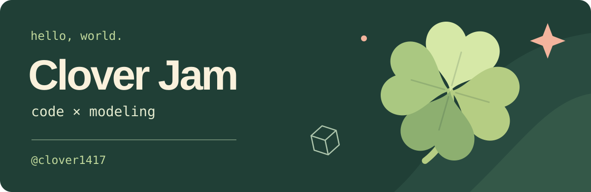

  <picture>
    <source media="(max-width: 600px)" srcset="./assets/clover-jam-mobile.svg" />
    
  </picture>

  <samp>I do the most stupid shit that you surely haven't seen before.</samp>

 

Hey, I'm **Clover**. I've spent the past **3 years making games and full-stack web projects**, mostly working on programming and 3D modeling.

Currently moving from **Roblox Studio to Unreal Engine 5**. Roblox's policies gave me some extra motivation to find a new home.

### 🌱 On my desk

  
  &nbsp;
  
  &nbsp;
  

**Blender & Roblox Studio** · Learning **Unreal Engine 5**

### 🛠️ Out in the wild

**[chromium-google-sync](https://github.com/clover1417/chromium-google-sync)**  
Set up Google Account Sync in Chromium on Linux, including ARM64 and snap builds, using your own credentials.

### 🍀 Build something together?

Happy to talk code, swap modeling notes, or learn Unreal together. Programming has pair-programming. I guess this is **pair-unrealengine**.

[Browse my projects](https://github.com/clover1417?tab=repositories)

 

<samp>✦ &nbsp; clover1417 &nbsp; ✦</samp>

