  <picture>
    <source media="(prefers-reduced-motion: reduce) and (max-width: 600px)" srcset="./assets/terminal-mobile-static.svg" />
    <source media="(prefers-reduced-motion: reduce)" srcset="./assets/terminal-static.svg" />
    <source media="(max-width: 600px)" srcset="./assets/terminal-mobile.svg" />
    
  </picture>

  <picture>
    <source media="(prefers-reduced-motion: reduce) and (max-width: 600px)" srcset="./assets/slogan-mobile-static.svg" />
    <source media="(prefers-reduced-motion: reduce)" srcset="./assets/slogan-static.svg" />
    <source media="(max-width: 600px)" srcset="./assets/slogan-mobile.svg" />
    
  </picture>

<h3><samp>$ cat ~/about.txt</samp></h3>

Hey, I'm **Clover**. I've spent the past **3 years making games and full-stack web projects**, mostly working on programming and 3D modeling.

Currently moving from **Roblox Studio to Unreal Engine 5**. Roblox's policies gave me some extra motivation to find a new home.

<h3><samp>$ ls ~/toolchain</samp></h3>

  
  &nbsp;
  
  &nbsp;
  

**Blender & Roblox Studio** · Learning **Unreal Engine 5**

<h3><samp>$ ls ~/projects</samp></h3>

**[chromium-google-sync](https://github.com/clover1417/chromium-google-sync)**  
Set up Google Account Sync in Chromium on Linux, including ARM64 and snap builds, using your own credentials.

<h3><samp>$ ./pair-unrealengine</samp></h3>

Happy to talk code, swap modeling notes, or learn Unreal together. Programming has pair-programming. I guess this is **pair-unrealengine**.

[Browse my projects](https://github.com/clover1417?tab=repositories)

 

<samp>[ clover1417@github ~ ]</samp>

